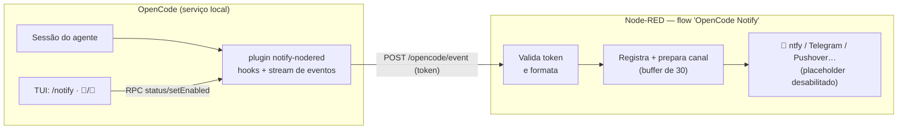

# notify-opencode

> **Notificações do OpenCode no seu celular via Node-RED** — saiba quando uma
> sessão termina, faz uma pergunta, pede permissão ou falha, sem ficar olhando
> pro terminal.

[](https://github.com/Brook-sys/notify-opencode/actions/workflows/ci.yml)
[](LICENSE)
[](https://opencode.ai)
[](https://nodered.org)

Plugin para o [OpenCode](https://opencode.ai) (V2) que observa as sessões e
empurra eventos de webhook para um flow [Node-RED](https://nodered.org) — que
formata, prioriza e entrega em **qualquer canal** (ntfy, Telegram, Pushover,
e-mail…). Cada sessão tem um **toggle de notificação próprio, ligado por
padrão**, controlado de dentro da própria TUI do OpenCode com `/notify`.

## Como funciona



## Gatilhos

| Evento | Quando dispara | Prioridade sugerida |
|---|---|---|
| `question` | O agente usou a tool `question` e espera resposta (com texto e opções) | alta |
| `permission` | Uma ação aguarda sua aprovação (sessão travada) | alta |
| `done` | O turno terminou com sucesso (com preview e duração) | normal |
| `error` | O turno falhou | urgente |

Comportamentos incluídos de fábrica: notificação **por sessão** (default
ligada), supressão de `done` de **subagentes**, turnos **interrompidos** não
avisam, envio **fire-and-forget** (timeout 4 s — o pipeline morto nunca
trava uma sessão) e deduplicação entre instâncias do plugin.

## Status de verificação (nada aqui é "deve funcionar")

Testado de ponta a ponta contra OpenCode **2.1.4** + Node-RED real:

| Verificação | Resultado |
|---|---|
| `done` de sessão real no webhook | ✅ 1× (dedupe entre 3 locations), com preview |
| `question` real (tool `question`) | ✅ com texto e opções |
| `permission` com regra `ask` real | ✅ + aprovação via API (`decision: once`) |
| `error` (`session.execution.failed`) | ⚠️ implementado por simetria — sem reprodução real na 2.1.4 |
| Toggle por sessão (OFF → sem eventos; ON → volta) | ✅ via RPC (o mesmo caminho do `/notify`) |
| Token inválido | ✅ 401 |
| Re-deploy do flow | ✅ idempotente (PUT, sem duplicar aba) |
| TUI: comando `/notify` na paleta | ✅ verificado em pty real |

Detalhes do desenho: [docs/arquitetura.md](docs/arquitetura.md).

## Instalação

### 1. Plugin (OpenCode)

Clone o repositório e registre no `~/.config/opencode/opencode.jsonc`
(recarregamento a quente — sem restart):

```jsonc
{
  "plugins": [
    {
      "package": "/caminho/do/clone/notify-opencode/plugin",
      "options": {
        "url": "http://SEU-NODE-RED:1880/opencode/event",
        "token": "um-token-aleatorio-bem-longo",
        "debug": true
      }
    }
  ]
}
```

Confirme: `opencode api get /api/plugin | grep notify-nodered`.

> Gere o token com `openssl rand -hex 24` (ou similar). Ele **nunca** é
> comitado — o repositório usa o placeholder `__OC_WEBHOOK_TOKEN__`.

### 2. Flow (Node-RED)

```sh
npm run flow:apply    # deploy idempotente via API — lê o token do opencode.jsonc
```

### 3. Canal de notificação

No editor do Node-RED, aba **OpenCode Notify**: habilite o nó
**"CANAL ntfy (placeholder)"** e aponte para o seu tópico — ou ligue
Telegram/Pushover na mesma saída (instruções passo a passo em
[docs/nodered.md](docs/nodered.md#plugar-um-canal)).

### 4. Teste

```sh
npm run flow:test     # 4 eventos falsos + 401 com token errado + buffer
```

Depois rode um turno real no OpenCode e confira
`curl -s http://SEU-NODE-RED:1880/opencode/events`.

> A TUI carrega o lado `/notify` **na abertura** — reinicie o terminal depois
> de instalar.

## Uso

- **`/notify`** na sessão → seletor 🔔 Ligadas / 🔕 Desligadas (ou `/notify on|off`);
- Rodapé da sessão mostra o estado; sessões novas nascem **ligadas**;
- Toggle também funciona via API (sessões headless):
  ```sh
  opencode api post /api/rpc/notify-nodered/setEnabled \
    --data '{"input":{"sessionID":"ses_…","enabled":false}}'
  ```

## Configuração (options do plugin)

| Opção | Padrão | Descrição |
|---|---|---|
| `url` | `http://SEU-NODE-RED:1880/opencode/event` | URL do webhook (troque pro seu) |
| `token` | env `OPENCODE_NOTIFY_TOKEN` | Enviado no header `x-webhook-token` |
| `minDurationSec` | `0` | Suprime `done` mais curto que N segundos |
| `includePreview` | `true` | Inclui preview da última resposta no `done` |
| `includeQuestionText` | `true` | Inclui texto da pergunta no `question` |
| `debug` | `false` | Log JSONL de diagnóstico (o quê enviou/pulou e por quê) |
| `debugLogPath` | `/tmp/opencode/notify-nodered-debug.jsonl` | Caminho do log de debug |

## Documentação

| Doc | Conteúdo |
|---|---|
| [docs/arquitetura.md](docs/arquitetura.md) | Visão profunda: instâncias por location, deduplicação em camadas, schema do payload, decisões e fragilidades |
| [docs/eventos.md](docs/eventos.md) | Referência dos eventos v2.1.4 verificados ao vivo + hooks + APIs correlatas |
| [docs/nodered.md](docs/nodered.md) | Flow nó a nó, endpoints, canais (ntfy/Telegram/Pushover) e segurança |
| [docs/operacao.md](docs/operacao.md) | Uso diário, diagnóstico passo a passo, troubleshooting, troca de token |
| [docs/ROADMAP.md](docs/ROADMAP.md) | Melhorias futuras: bidirecional (responder do celular), retry, custo na notificação… |
| [CHANGELOG.md](CHANGELOG.md) | Histórico de versões |
| [CONTRIBUTING.md](CONTRIBUTING.md) | Como contribuir, comandos e checklist de PR |

## Estrutura do repositório

```text
plugin/              Plugin OpenCode V2
  index.ts             lado servidor: hooks, stream, dedupe, toggle, envio
  tui.tsx              lado terminal: /notify, seletor, indicador 🔔/🔕
  rpc.ts               contrato RPC (status / setEnabled)
  package.json         exports do plugin (server + tui + rpc)
nodered/              Lado Node-RED
  flow.template.mjs    fonte da verdade do flow (legível)
  flow.json            artefato gerado para importação manual (placeholder)
scripts/
  apply-nodered-flow.mjs   deploy idempotente via API do Node-RED
  test-send-event.mjs     teste de ponta com eventos falsos + 401
  validate-flow.mjs       validação estrutural (npm test / CI)
  smoke-plugin/            utilitário de descoberta de eventos (documentação viva)
docs/                 Documentação por área
.github/              CI + templates de issue
```

## Limitações conhecidas

- `session.execution.failed` não foi reproduzido ao vivo na 2.1.4 — o gatilho
  `error` existe por simetria com `succeeded`;
- **sem retry**: Node-RED fora no momento do evento = evento perdido (fica no
  debug log);
- o buffer de eventos do Node-RED é volátil (memória do contexto);
- o gatilho `permission` depende de regras `ask` — a política base da V2 é
  `allow` para tudo;
- `/notify` exige TUI; sessões headless ficam sempre ligadas (toggle via RPC
  disponível).

## Segurança

- O token do webhook nunca é comitado (placeholder no repositório, valor real
  só no `opencode.jsonc` e no flow deployado);
- **configure `adminAuth` no Node-RED** — o editor aberto na rede privada é
  superfície de ataque (veja [docs/operacao.md](docs/operacao.md#segurança-pendências-recomendadas));
- conteúdo sensível no preview/pergunta? Prefira ntfy self-hosted ao ntfy.sh
  público.

## Licença

[MIT](LICENSE) © Brook-sys
