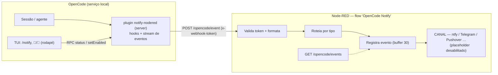
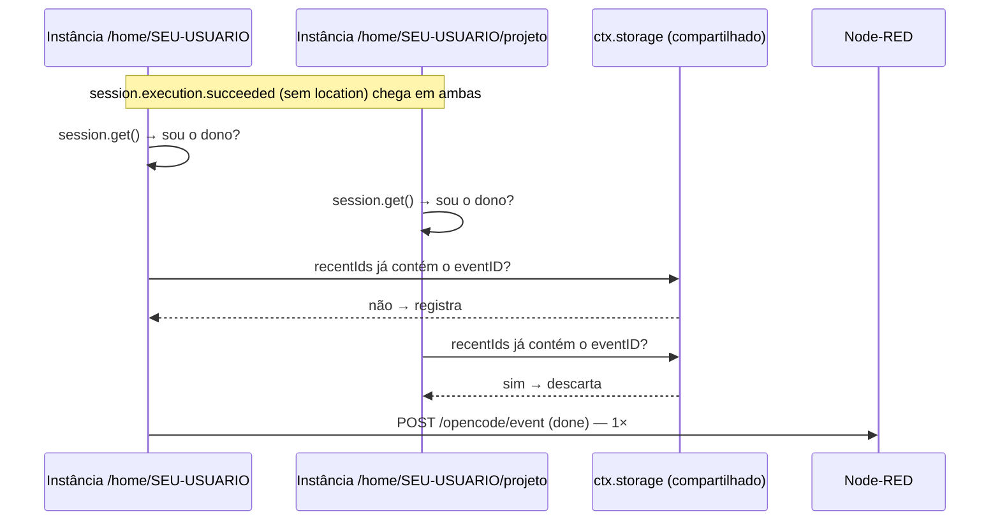

# Arquitetura

Como o `notify-opencode` funciona por dentro — decisões, restrições da plataforma
(OpenCode V2 / 2.1.4) e o desenho de cada peça. Para a verdade sobre nomes e
shapes de eventos, veja [eventos.md](eventos.md); para o lado Node-RED,
[nodered.md](nodered.md).

## Visão geral



## Os dois lados do plugin

O plugin OpenCode V2 tem duas superfícies, registradas no `package.json` dele:

| Arquivo | Roda em | Papel |
|---|---|---|
| `plugin/index.ts` | serviço compartilhado (server) | Escuta hooks e o stream público, decide o que notifica, envia ao webhook, guarda o estado do toggle |
| `plugin/tui.tsx` | cada processo de terminal (CLI) | Comando `/notify`, seletor Ligado/Desligado, indicador 🔔/🔕 no rodapé |
| `plugin/rpc.ts` | ambos | Contrato RPC (`status`, `setEnabled`) — o servidor é a fonte da verdade; a TUI só chama |

O carregamento é a quente: editar os arquivos e `opencode api post /api/location/reload`
basta para o lado servidor. O lado TUI carrega na **abertura** do terminal —
reinicie a TUI para ver mudanças em `tui.tsx`.

## Instâncias por location — o problema central

O OpenCode carrega **uma instância do plugin por location** (projetos carregados
no serviço). Com três locations, `plugin.setup()` roda três vezes — e
**cada instância assina o stream inteiro de eventos**, recebendo uma cópia de
cada evento. Sem cuidado, uma notificação de "terminou" chegaria 3×.

Fatos verificados na 2.1.4 que definiram o desenho:

1. **Eventos do stream chegam 1× por location** (3 locations = 3 cópias);
2. **Hooks (`tool.execute.before`, `permission.evaluate`) disparam 1× no total**,
   na instância que processa a sessão;
3. **Alguns eventos carregam `location`, outros não** — `session.text.ended`
   carrega; `session.execution.succeeded/failed` (os que importam para "terminou")
   **não carregam**;
4. O **módulo não é compartilhado** entre instâncias (estado em escopo de módulo
   é por instância), mas o **`ctx.storage` do plugin é compartilhado** entre elas.

## Deduplicação em camadas



1. **Filtro por location** (`event.location.directory`): descarta cópias de
   eventos que carregam location e não são daqui;
2. **Ownership check** (`ctx.session.get().location.directory === ctx.location.directory`):
   para eventos sem location, só a instância dona da sessão envia. É a camada
   principal — verificada ao vivo (antes dela, `done` chegava 3×; depois, 1×);
3. **LRU de ids no storage compartilhado** (`recentIds`, últimos 80): rede de
   segurança para o caso raro de `session.get` falhar em todas as instâncias ao
   mesmo tempo — o primeiro a registrar o `eventID` vence.

Hooks não precisam disso: disparam uma única vez por sessão.

## Estado do toggle (por sessão, default ligado)

- Vida no `ctx.storage` (compartilhado), chave `state` → `{ disabled: { [sessionID]: true } }`;
- **Ausência = habilitado** — toda sessão nova nasce ligada, sem escrever nada;
- A TUI (e qualquer cliente) altera via RPC; via HTTP a chamada precisa do
  wrapper: `POST /api/rpc/notify-nodered/setEnabled` com `{"input":{…}}`
  (o cliente gerado da TUI embrulha sozinho);
- Sessão deletada → entrada removida do conjunto (higiene, via evento defensivo).

## O caminho da notificação

```ts
send(payload) → fetch(url, { headers: { "x-webhook-token": token }, body })
```

- **Fire-and-forget**: nada no caminho crítico da sessão faz `await` no envio;
- **Timeout de 4 s** via `AbortController` — Node-RED fora/latindo não atrasa a sessão;
- Erros só aparecem no debug log (`send.error`, `send.http-error`); o evento
  **não tem retry** (perde se o Node-RED estiver fora — item do [roadmap](ROADMAP.md)).

### Schema do payload (POST no webhook)

| Campo | Tipos | Descrição |
|---|---|---|
| `type` | todos | `question` \| `permission` \| `done` \| `error` |
| `sessionID` | todos | id da sessão |
| `title` | done/error | título da sessão |
| `preview` | done/error | últimas palavras da resposta (até 280 chars, se `includePreview`) |
| `durationSec` | done/error | duração do turno, se conhecida |
| `question` | question | texto da pergunta (se `includeQuestionText`) |
| `header` | question | header da pergunta |
| `options` | question | labels das opções (até 6) |
| `action` | permission | ação avaliada (`shell`, …) |
| `resources` | permission | recursos/aguardando aprovação (até 4) |
| `from` | todos | location de origem (adicionado no envio) |
| `ts` | todos | epoch ms (adicionado no envio) |

## Decisões explícitas (o que NÃO fazemos e por quê)

| Decisão | Motivo |
|---|---|
| Sem retry/fila de envio | Simplicidade da v0.1; um outage de Node-RED não pode acumular débito na sessão. Fila persistente está no roadmap |
| Turno interrompido não notifica | Quem interrompeu foi o usuário — ele já sabe |
| `done` de subagente suprimido (`parentID`) | O que importa é o turno da sessão principal; notificar 10 subagentes seria ruído |
| `minDurationSec` filtra turnos curtíssimos | Opção para reduzir ruído (default 0 = desligado) |
| Nenhum `await` no caminho da sessão | Notificação é efeito colateral; nunca pode travar/quebrar o agente |
| Token por header, não na URL | Evita vazamento em logs de proxy/access log |

## Fragilidades conhecidas (honestidade técnica)

- **`session.execution.failed` não reproduzido ao vivo** na 2.1.4 — implementado
  por simetria com `succeeded`; se a OpenCode renomear, o `error` silencia
  silenciosamente (o debug log mostra `event.unhandled` para depurar);
- **Recarregamentos sucessivos** podem acumular instâncias duplicadas por
  location (`location/reload` empilha); a dedupe cobre o `done`, e um
  `opencode service restart` consolida — mas **derruba sessões em andamento**;
- **`session.get` por fim de turno** adiciona uma chamada local por notificação
  — barato hoje, mas é I/O extra no caminho;
- O LRU de ids tem janela de corrida minúscula (duas instâncias gravando ao
  mesmo tempo) — aceitável: o pior caso é uma notificação duplicada rara, e a
  camada 2 (ownership) já impede o caso comum.
