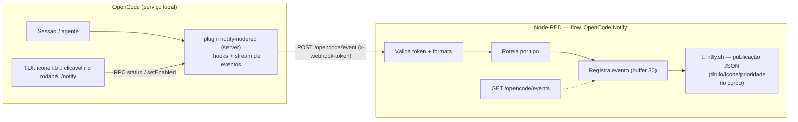
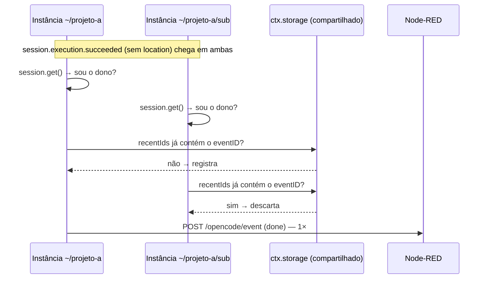
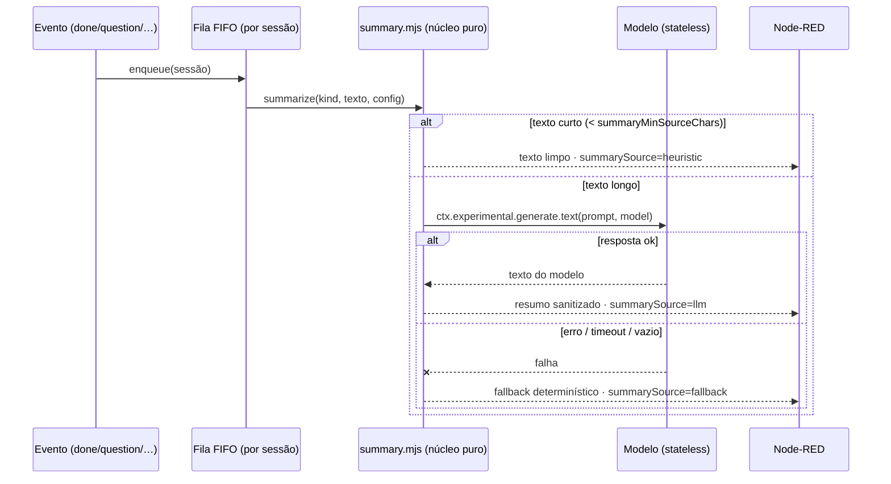

# Arquitetura

Como o `notify-opencode` funciona por dentro — decisões, restrições da plataforma
(OpenCode V2 / 2.1.4) e o desenho de cada peça. Para a verdade sobre nomes e
shapes de eventos, veja [eventos.md](eventos.md); para o lado Node-RED,
[nodered.md](nodered.md).

## Visão geral



## Os dois lados do plugin

O plugin OpenCode V2 tem duas superfícies, registradas no `package.json` dele:

| Arquivo | Roda em | Papel |
|---|---|---|
| `plugin/index.ts` | serviço compartilhado (server) | Escuta hooks e o stream público, decide o que notifica, monta o resumo, envia ao webhook, guarda o estado do toggle |
| `plugin/summary.mjs` | server (importado pelo `index.ts`) | Núcleo **puro** do resumo: limpeza, corte, prompt, sanitização, timeout, fallback — sem I/O e sem dependências |
| `plugin/summary.d.mts` | editor/tsc | Tipos do núcleo (o runtime carrega o `.mjs`) |
| `plugin/tui.tsx` | cada processo de terminal (CLI) | Ícone 🔔/🔕 **clicável** no rodapé, comando `/notify`, seletor Ligado/Desligado |
| `plugin/rpc.ts` | ambos | Contrato RPC (`status`, `setEnabled`) — o servidor é a fonte da verdade; a TUI só chama |

O carregamento é a quente: editar os arquivos e `opencode api post /api/location/reload`
basta para o lado servidor. O lado TUI carrega na **abertura** do terminal —
reinicie a TUI para ver mudanças em `tui.tsx`.

## Instâncias por location — o problema central

O OpenCode carrega **uma instância do plugin por location** (projetos carregados
no serviço). Com três locations, `plugin.setup()` roda três vezes — e
**cada instância assina o stream inteiro de eventos**, recebendo uma cópia de
cada evento. Sem cuidado, uma notificação de "terminou" chegaria 3×.

Fatos verificados na 2.1.4 que definiram o desenho:

1. **Eventos do stream chegam 1× por location** (3 locations = 3 cópias);
2. **Hooks (`tool.execute.before`, `permission.evaluate`) disparam 1× no total**,
   na instância que processa a sessão;
3. **Alguns eventos carregam `location`, outros não** — `session.text.ended`
   carrega; `session.execution.succeeded/failed` (os que importam para "terminou")
   **não carregam**;
4. O **módulo não é compartilhado** entre instâncias (estado em escopo de módulo
   é por instância), mas o **`ctx.storage` do plugin é compartilhado** entre elas.

## Deduplicação em camadas



1. **Filtro por location** (`event.location.directory`): descarta cópias de
   eventos que carregam location e não são daqui;
2. **Ownership check** (`ctx.session.get().location.directory === ctx.location.directory`):
   para eventos sem location, só a instância dona da sessão envia. É a camada
   principal — verificada ao vivo (antes dela, `done` chegava 3×; depois, 1×);
3. **LRU de ids no storage compartilhado** (`recentIds`, últimos 80): rede de
   segurança para o caso raro de `session.get` falhar em todas as instâncias ao
   mesmo tempo — o primeiro a registrar o `eventID` vence.

Hooks não precisam disso: disparam uma única vez por sessão.

## Estado do toggle (por sessão, default ligado)

- Vida no `ctx.storage` (compartilhado), chave `state` → `{ disabled: { [sessionID]: true } }`;
- **Ausência = habilitado** — toda sessão nova nasce ligada, sem escrever nada;
- A TUI (e qualquer cliente) altera via RPC; via HTTP a chamada precisa do
  wrapper: `POST /api/rpc/notify-nodered/setEnabled` com `{"input":{…}}`
  (o cliente gerado da TUI embrulha sozinho);
- Sessão deletada → entrada removida do conjunto (higiene, via evento defensivo).

## O lado TUI: ícone clicável

O indicador 🔔/🔕 no slot `prompt.footer.status` é o controle principal:
um clique com o botão esquerdo alterna a sessão. Detalhes que vieram de
teste empírico na 2.1.4 (pty real + injeção de eventos SGR 1006):

- **Um clique é o par `down`+`up`** — o OpenTUI não sintetiza evento de
  "clique". O toggle só dispara no `up` do botão esquerdo se o `down`
  aconteceu sobre o ícone (`iconPressed`), o que descarta, por exemplo,
  arrastar uma seleção de texto e soltar em cima do ícone;
- `selectable={false}` no `<text>` e `stopPropagation()` no `up` — mesmo
  padrão dos componentes do próprio OpenCode (autocomplete, session tabs,
  diff viewer);
- **Coordenadas 0-based nos eventos**: um clique na célula (col 80, row 47)
  em escapes 1-based chega como `x:79, y:46`;
- **Cursor de ponteiro no hover** via `renderer.setMousePointer` — cosmético,
  engolido em caso de falha;
- **Hidratação**: 1× `status` por sessão em background na primeira render
  (o ícone nasce correto); o clique consulta o estado real no servidor antes
  de alternar — a TUI nunca decide sozinha;
- **Cache reativo** (`context.storage.store`) faz o ícone trocar na hora;
  o mesmo store é durável e sincronizado entre instâncias da TUI.

### Fragilidades de plataforma (verificadas, com mitigação no código)

1. **Toast com variante inválida derruba a TUI inteira** — o componente lê
   `theme.text.feedback[variant].base` sem guarda; `variant` fora de
   `info | success | warning | error` lança e o app crasha (aconteceu de
   verdade com `"default"`, que existia na 0.1.0). Mitigação: helper
   `showToast` com `try/catch` — todo toast do plugin passa por ele;
2. **Toast sobreposto não desenha** — `toast.show` enquanto outro toast está
   visível não renderiza (só espaçados). O toggle e o ícone seguem
   corretos; o toast é best-effort;
3. **O ícone some com o composer** — em sessão "working" com o footer
   oculto, o slot não renderiza. `/notify` e RPC continuam disponíveis.

## O caminho da notificação

```ts
send(payload) → fetch(url, { headers: { "x-webhook-token": token }, body })
```

- **Fire-and-forget**: nada no caminho crítico da sessão faz `await` no envio;
- **Timeout de 4 s** via `AbortController` — Node-RED fora/latindo não atrasa a sessão;
- Erros só aparecem no debug log (`send.error`, `send.http-error`); o evento
  **não tem retry** (perde se o Node-RED estiver fora — item do [roadmap](ROADMAP.md)).

### Schema do payload (POST no webhook)

| Campo | Tipos | Descrição |
|---|---|---|
| `type` | todos | `question` \| `permission` \| `done` \| `error` |
| `sessionID` | todos | id da sessão |
| `title` | done/error | título da sessão |
| `preview` | done/error | corpo final da notificação (com `summary: "llm"`, o mesmo conteúdo de `summary`) |
| `summary` | todos | corpo final da notificação (resumo do modelo ou texto limpo) — **só com `summary: "llm"`** |
| `summarySource` | todos | `llm` \| `heuristic` \| `fallback` \| `none` — **só com `summary: "llm"`** |
| `durationSec` | done/error | duração do turno, se conhecida |
| `question` | question | texto da pergunta (se `includeQuestionText`) |
| `header` | question | header da pergunta |
| `options` | question | labels das opções (até 6) |
| `action` | permission | ação avaliada (`shell`, …) |
| `resources` | permission | recursos/aguardando aprovação (até 4) |
| `from` | todos | location de origem (adicionado no envio) |
| `ts` | todos | epoch ms (adicionado no envio) |

## Camada 2 — resumo do corpo por IA (opt-in)

Com `summary: "llm"` o corpo da notificação passa a ser **um resumo gerado
pelo modelo**, em vez do texto bruto cortado. Default do repositório:
`"off"` — a feature é opt-in porque custa tokens, cota e latência.



### Por que `experimental.generate.text` e não `session.generate`

- **`experimental.generate.text` é stateless**: não cria sessão, não recebe
  tools, não escreve no histórico. Um resumo que abrisse uma sessão geraria
  eventos `session.execution.*` — e o próprio plugin escuta esses eventos:
  a recursão de notificação viraria estruturalmente possível. Com a
  primitiva stateless, ela é **impossível por construção**;
- `session.generate` usaria as tools do agente: o modelo poderia "agir"
  durante um resumo — não é o que se quer num texto que vai para o celular;
- o custo da requisição **não aparece** nas stats da sessão (fora do
  histórico). Isso é uma consequência de ser stateless, e é uma fonte de
  surpresas na conta do provider.

### O núcleo puro (`plugin/summary.mjs`)

Toda a lógica de resumo vive num módulo **sem I/O, sem rede e sem
dependências**, com o `generate` injetado:

| Função | Papel |
|---|---|
| `cleanText` | Remove blocos de código, markdown e caracteres de controle |
| `truncateAtSentence` | Corte em fronteira de frase (`prefer: "start"` \| `"end"`) |
| `buildPrompt` | Monta o prompt com o conteúdo como **dado** (delimitadores neutralizados) |
| `sanitizeOutput` | Limpa a saída do modelo (cercas, rótulo `Resumo:`, aspas, markdown) |
| `fallbackText` | Fallback determinístico (Camada 0) |
| `withTimeout` | `Promise.race` com deadline |
| `summarize` | Pipeline completo ( heurística → modelo → fallback) |

Por ser puro, ele roda em Node 22 sem flags no CI: `scripts/test-summary.mjs`
(18 testes) cobre o corte de frase, a neutralização do delimitador, a
sanitização da saída, o timeout, a resposta vazia e o teto de entrada.

### Decisões de UX (e o que elas custam)

| Decisão | Motivo | Custo |
|---|---|---|
| **Uma notificação por evento** | O requisito é uma notificação por evento; duas (corpo bruto + resumo) viram spam no celular | O corpo final pode ser o fallback, mesmo tendo o modelo respondido depois |
| **Texto curto → heurística instantânea** | Não gastar cota com "pronto" | Nenhum resumo "inteligente" em textos curtos (que já são legíveis) |
| **O hook nunca bloqueia o agente** | `question`/`permission` estão no caminho crítico da sessão | A notificação sai depois da resposta do modelo (5–60 s no ambiente medido) |
| **Fila FIFO por sessão** | Dois eventos próximos não podem sair fora de ordem por causa da latência do resumo | O segundo evento espera o primeiro |
| **Fallback determinístico obrigatório** | Falha do modelo não pode virar notificação ausente | O corpo pode ser menos bom que o resumo (é o texto cortado) |

### Fragilidades da Camada 2

- **Latência**: 4,8 s (prompt curto) a 64 s (provider sob carga) — a notificação
  de um texto longo **espera** o modelo;
- **O timeout não cancela a requisição**: o `Promise.race` abandona a
  promessa, mas a chamada no provider continua viva e consumindo cota;
- **Auto-contenção**: se o `summaryModel` for o mesmo provider que serve o
  agente, o resumo disputa fila com o próximo turno do agente. Use um
  `summaryModel` diferente quando puder;
- **O resumo pode estar errado**: o modelo pode inventar ou distorcer. O
  alcance do dano é o texto na tela do celular — a requisição não tem tools
  e não executa nada;
- **O custo não aparece nas stats da sessão** (stateless) — o consumo aparece
  na fatura do provider, não no OpenCode.

## Decisões explícitas (o que NÃO fazemos e por quê)

| Decisão | Motivo |
|---|---|
| Sem retry/fila de envio | Simplicidade da v0.1; um outage de Node-RED não pode acumular débito na sessão. Fila persistente está no roadmap |
| Turno interrompido não notifica | Quem interrompeu foi o usuário — ele já sabe |
| `done` de subagente suprimido (`parentID`) | O que importa é o turno da sessão principal; notificar 10 subagentes seria ruído |
| `minDurationSec` filtra turnos curtíssimos | Opção para reduzir ruído (default 0 = desligado) |
| Nenhum `await` no caminho da sessão | Notificação é efeito colateral; nunca pode travar/quebrar o agente |
| Token por header, não na URL | Evita vazamento em logs de proxy/access log |
| Resumo por IA **opt-in** (`summary: "off"`) | Custa tokens, cota e latência; quem não pedir, não paga |
| `experimental.generate.text` (stateless) em vez de `session.generate` | Sem tools e sem eventos de sessão: recursão de notificação estruturalmente impossível |
| O conteúdo do resumo entra como **dado**, com delimitadores neutralizados | O texto resumido pode conter instruções (prompt injection); neutralizar `<`/`>` impede forjar o fim do bloco |

## Fragilidades conhecidas (honestidade técnica)

- **`session.execution.failed` não reproduzido ao vivo** na 2.1.4 — implementado
  por simetria com `succeeded`; se a OpenCode renomear, o `error` silencia
  silenciosamente (o debug log mostra `event.unhandled` para depurar);
- **Recarregamentos sucessivos** podem acumular instâncias duplicadas por
  location (`location/reload` empilha); a dedupe cobre o `done`, e um
  `opencode service restart` consolida — mas **derruba sessões em andamento**;
- **`session.get` por fim de turno** adiciona uma chamada local por notificação
  — barato hoje, mas é I/O extra no caminho;
- O LRU de ids tem janela de corrida minúscula (duas instâncias gravando ao
  mesmo tempo) — aceitável: o pior caso é uma notificação duplicada rara, e a
  camada 2 (ownership) já impede o caso comum.
